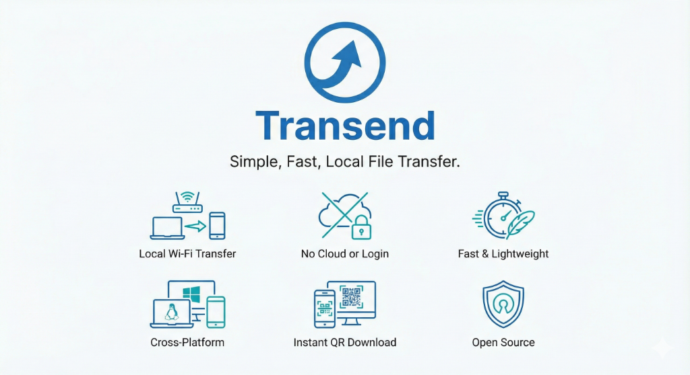
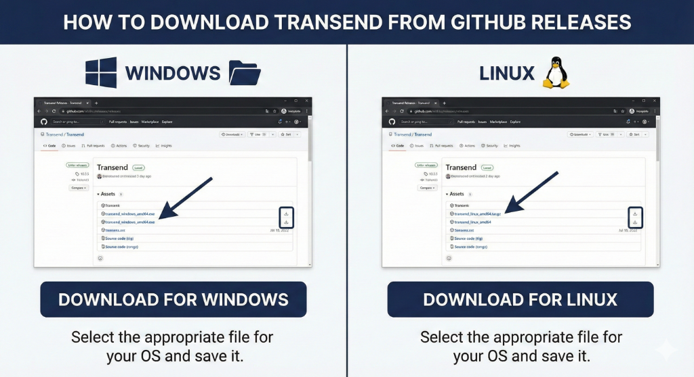
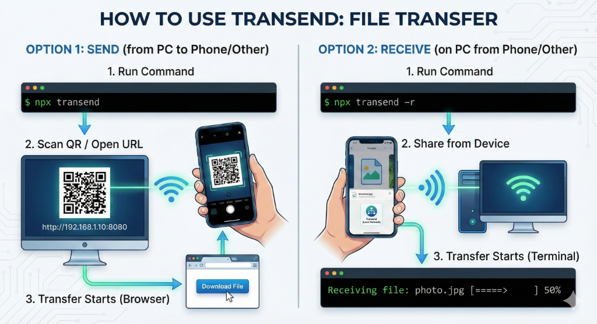

# PeerHop - Local File Transfer



PeerHop is a lightning-fast tool to share files between devices on your local network. No cloud, no internet required—just direct peer-to-peer transfer via WiFi.

[](https://www.npmjs.com/package/peerhop)

## 📥 Downloads



| OS                | Download Link                                                                                                 |
| ----------------- | ------------------------------------------------------------------------------------------------------------- |
| **Windows** (x64) | [**peerhop_setup.exe**](https://github.com/ashrafbinahmad/peerhop/releases/latest/download/peerhop_setup.exe) |
| **Linux** (x64)   | [**peerhop-linux**](https://github.com/ashrafbinahmad/peerhop/releases/latest/download/peerhop-linux)         |

## 🚀 Quick Start (No Install)

If you have Node.js installed, just run:

```bash
npx peerhop <file>
```

## 📦 Installation

### Windows

1. Download [peerhop.exe](https://github.com/ashrafbinahmad/peerhop/releases/latest/download/peerhop.exe).
2. Add it to your PATH or run it directly from PowerShell/CMD.

### Linux (Apt-Get / Manual)

**Standard Install (One-line)**:

```bash
curl -L https://github.com/ashrafbinahmad/peerhop/releases/latest/download/peerhop-linux -o peerhop && chmod +x peerhop && sudo mv peerhop /usr/local/bin/
```

**Install via Apt (Debian/Ubuntu)**:
_Coming soon! For now, please use the command above or NPM._

```bash
# sudo add-apt-repository ppa:peerhop/stable
# sudo apt-get update
# sudo apt-get install peerhop
```

### NPM (Cross-Platform)

```bash
npm install -g peerhop
```

## 🛠 Usage



### Sending Files

```bash
# Send a single file
peerhop image.png

# Send multiple files (automatically zipped)
peerhop photo1.jpg photo2.jpg documents/
```

### Receiving Files

```bash
peerhop -r
```

1. Run the command.
2. Scan the QR code with a phone.
3. Select files on the phone to upload.

## 📱 Desktop GUI

A native, lightweight GUI (Wails) is included.

```bash
# Run the standalone executable
peerhop.exe
```

## 🧠 Architecture & Codebase

PeerHop is built with **Go** for high performance and uses **React** for the user interface, bundled together using **Wails** for the desktop application. The core engine is a lightweight HTTP server that streams files directly between devices over the local network (LAN) without routing through external servers.

### Directory Structure

- **`/cmd`**: Contains the CLI entry points for running PeerHop without the GUI.
- **`/pkg`**: The core Go backend packages.
  - **`server/`**: HTTP server logic, WebSocket implementation for real-time progress, and routing.
  - **`network/`**: Network discovery, IP resolution, and connection handling.
  - **`logger/`**: Custom logging utilities.
  - **`utils/`**: Helper functions (e.g., zip creation, file handling).
- **`/ui`**: The Wails desktop GUI application.
  - **`main.go` / `app.go`**: Wails application lifecycle and Go bindings for the frontend.
  - **`frontend/`**: The React, Vite, and TailwindCSS codebase for the user interface.
- **`/npm-package` & `/scripts`**: Build and distribution scripts for NPM, Windows, and Linux releases.

### Key Technologies
- **Backend**: Go (Golang)
- **Frontend**: React, TypeScript, Vite, TailwindCSS
- **Desktop Framework**: Wails v2
- **Distribution**: NPM, GitHub Releases, APT (coming soon)
